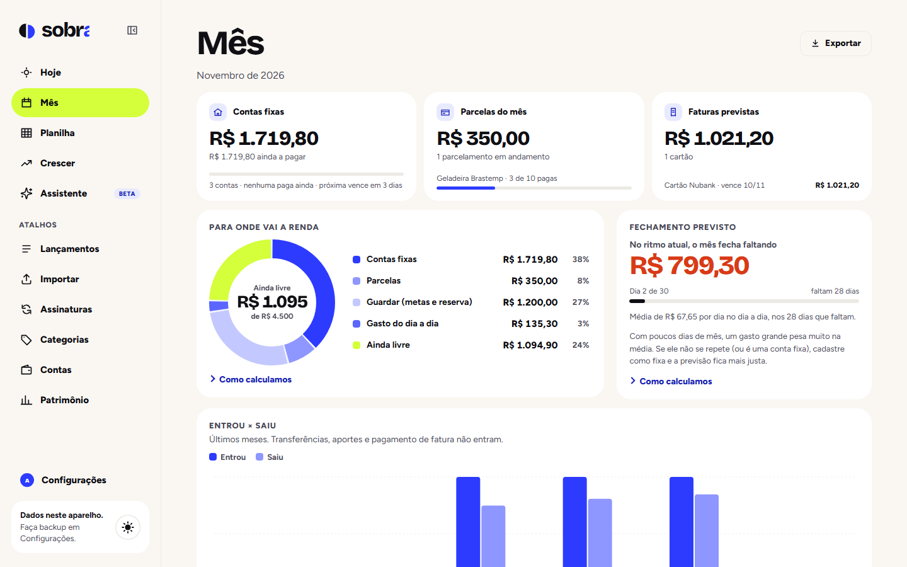

 

<picture>
  <source media="(prefers-color-scheme: dark)" srcset="screenshots/logo-dark.png" />
  
</picture>

**Passeie pelo mês. Veja o que sobra.**

Um jeito mais simples de organizar seu dinheiro, acompanhar seus gastos e planejar o que você quer conquistar.

[**Abrir a demo →**](https://analuizaalvesm.github.io/sobra-demo/)

 

 

> [!NOTE]
> O Sobra ainda está em fase de testes. Seus dados ficam salvos localmente no navegador, sem envio para servidores. Se limpar os dados do navegador, você pode perder suas informações. Para evitar isso, faça um backup em **Configurações**.

## Funcionalidades

- Acompanhe quanto ainda pode gastar até o fim do mês.
- Organize contas fixas, parcelas e faturas.
- Planeje sua reserva de emergência e suas próximas metas.
- Acompanhe seu patrimônio e investimentos.
- Aprenda sobre finanças com lições curtas e práticas.

## Começando

1. Acesse a [demo](https://analuizaalvesm.github.io/sobra-demo/) e clique em **Começar grátis**.
2. Crie sua conta e informe sua renda, data de pagamento, contas e reserva inicial.
3. Registre seus gastos, importe um extrato ou fatura (OFX/CSV) e comece a organizar suas metas.

 

Os valores apresentados são fictícios. As simulações têm caráter ilustrativo e não constituem recomendações de investimento.

