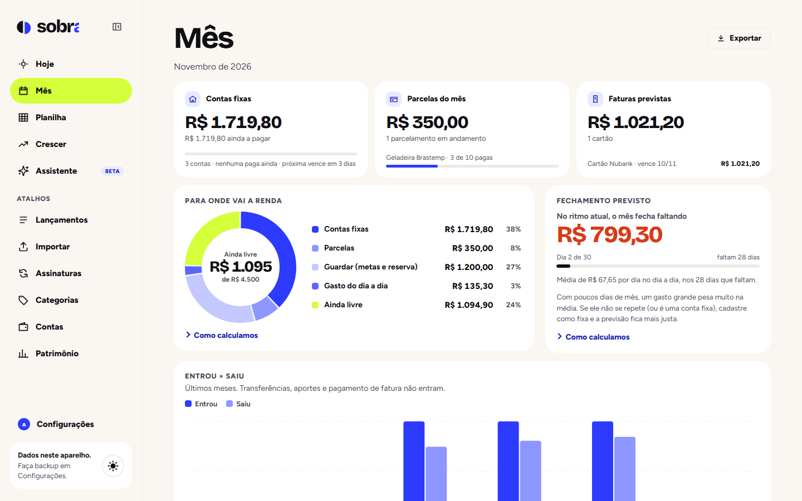

 

<picture>
  <source media="(prefers-color-scheme: dark)" srcset="screenshots/logo-dark.png" />
  
</picture>

**Passeie pelo mês. Veja o que sobra.**

Um jeito mais simples de organizar seu dinheiro, acompanhar seus gastos e planejar o que você quer conquistar.

[**Abrir a demo →**](https://analuizaalvesm.github.io/sobra-demo/)

 

 

> [!NOTE]
> O Sobra ainda está em fase de testes. A demo mostra o site; a área logada (criar conta e entrar) ainda não está aberta ao público, porque a conta passou a morar no servidor da Sobra e ele ainda não foi publicado.

## Funcionalidades

- Acompanhe quanto ainda pode gastar até o fim do mês.
- Organize contas fixas, parcelas e faturas.
- Planeje sua reserva de emergência e suas próximas metas.
- Acompanhe seu patrimônio e investimentos.
- Aprenda sobre finanças com lições curtas e práticas.

## Começando

1. Acesse a [demo](https://analuizaalvesm.github.io/sobra-demo/) e passeie pelo site: o mês de exemplo, a divisão do salário, a reserva, a simulação de metas e os planos.
2. Quando o servidor for publicado, **Começar grátis** cria a conta e leva para o app.

 

Os valores apresentados são fictícios. As simulações têm caráter ilustrativo e não constituem recomendações de investimento.

